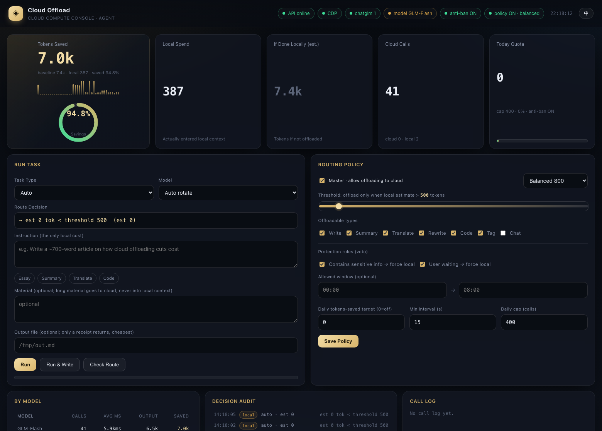

# Cloud Offload · Cloud Compute Offloading Layer

English | [中文](README.md)

Offload token-hungry long tasks (long-form writing, summarization, translation, rewriting, code) to **cloud web compute**. The local agent sends one short instruction and receives one short receipt — **the generated body never enters local context**.

## 0 In one line
Local sends an instruction -> cloud produces the artifact -> artifact is written straight to disk. Locally you only see size / latency / how many tokens were saved.

## 1 Accounting (v3)

| Quantity | Definition |
|---|---|
| Saved tokens | est(instruction) + est(material) + est(output) — **input + output both counted** |
| Local spend | est(receipt) (compressed to about 4 tokens) |
| Baseline | saved + local spend |
| **Savings ratio** | saved / baseline |

On a cache hit: **zero cloud calls, zero waiting**, and the saving is still counted.

Estimator (calibrated against gpt-tokenizer cl100k_base):
- CJK: 1.0616 token/char
- ASCII: 0.3048 token/char
- Other: 0.9 token/char
- Corpus MAPE **4.0%** (the old chars/1.5 rule was 77.7%)

## 2 Quick start

    curl -s http://127.0.0.1:8788/health            # expect glmPages>=1
    node cloud-offload.mjs --task "Write a ~900-word explainer on X" --out /tmp/out.md
    open http://127.0.0.1:8788/                     # dashboard (switch to English with the EN button)

## 3 For agents
Read the skill first: workshop-skills/cloud-offload/SKILL.md.
- **Use when**: expected output > ~800 tokens — long articles, reports, long code, full-document summary/translation/rewrite; or material of thousands of characters.
- **Do not use for**: interactive Q&A, greetings, short replies, multi-turn follow-ups, or private/secret content.
- **Steps**: health check -> optional route check -> dispatch with --out -> verify (complete:true and truncated:false).
- **Hard rules**: never pull the body into local context; stay serial; degrade to local on failure, retry at most twice.

## 4 Complex tasks: collaborative execution
Decompose locally, generate in segments on the cloud, assemble locally:

    node cloud-offload-batch.mjs --spec plan.json --out report.md

plan.json:

    { "title": "...", "type": "write", "model": "GLM-Flash", "parts": [ { "heading": "...", "task": "..." } ] }

Measured: a 4-part report assembled into a 5037-byte document, 89% savings ratio.

## 5 Install & configure (any agent / any machine)
Requirements: macOS (launchd), Node.js >= 20, Microsoft Edge, one logged-in chatglm.cn account.

    bash scripts/install.sh      # generates the three launchd services for the current user

The installer checks Node/Edge, creates a token, writes the plists with your own paths, and bootstraps them. Log in to chatglm.cn once in the dedicated Edge profile (~/.edge-cloud-offload).

| Key | Default | Meaning |
|---|---|---|
| API_PORT | 8788 | gateway port |
| CDP_URL | http://127.0.0.1:9222 | automation browser debug port |
| BRIDGE_URL | http://127.0.0.1:8787 | local tool bridge |
| ANSWER_TIMEOUT_MS | 300000 | hard cap per generation |
| OFFLOAD_LEDGER | token-ledger.jsonl in project | ledger path |
| settings.json | template in config.example.json | routing policy |

## 6 Trade-offs

| You get | You pay |
|---|---|
| Large local token savings; context stays clean | Depends on a web session (not an official API); a UI change can break it |
| One-command long-output to disk; only a receipt returns | Single browser page is **serial**; about 2-4 calls/min |
| Transparent dashboard: savings, reasons, call log | Anti-ban limits: min interval + daily cap |
| Completion detection tuned for long-thinking models | Token counts are estimates (MAPE 4%, ~±10%) |

## 7 How much money this saves
- Saved tokens x your local model price. Reference: GPT-4o-class about $10 per 1M output tokens; Chinese flagships about CNY 10-30 per 1M.
- Example: one 500-word article saves about 480 tokens; a 10,000-word document saves 9,000+.
- At scale: 100 long tasks per day saving 1,500 tokens each -> about **4.5M tokens/month** -> roughly **$45 / CNY 90**.
- **The bigger win is not money**: long bodies no longer blow up the local context, causing compaction, quality loss and session breaks.

## 8 Why it matters
1. Move the expensive part out: generation is a compute problem and should not spend the conversation model context budget.
2. Auditable: every decision and every saved token is logged and shown on the dashboard.
3. Portable: any agent that can call HTTP or run a command can deploy it on its own terms.

## 9 Architecture

    cloud-offload-api.mjs   CDP-driven chatglm in Edge; serves /api/* and OpenAI-compatible /v1/*
    cloud-offload.mjs       CLI: --task / --material-file / --out / --system
    cloud-offload-batch.mjs CLI: complex tasks, decompose -> generate parts -> assemble
    bridge.mjs              local tool bridge (run_shell / read_file / write_file / list_dir / http_get)
    public/index.html       dashboard (single-file SPA, no external deps, zh/en toggle)
    tests/                  functional / stress / token-accuracy tests
    docs/                   test report, optimization study, screenshots
    scripts/install.sh      one-command install

## 10 Tests

    node tests/run-tests.mjs         # functional + stress, 13 cases
    node tests/token-accuracy.mjs    # estimator accuracy (needs gpt-tokenizer)

See docs/质量强度测试报告.md (Chinese).

## 11 License
PolyForm Noncommercial License 1.0.0 — no commercial / for-profit use or resale. See LICENSE.
Required Notice: Copyright (c) 2026 William-Trader

> Disclaimer: a personal automation experiment, not affiliated with chatglm.cn / Zhipu. Respect the target site terms of service.