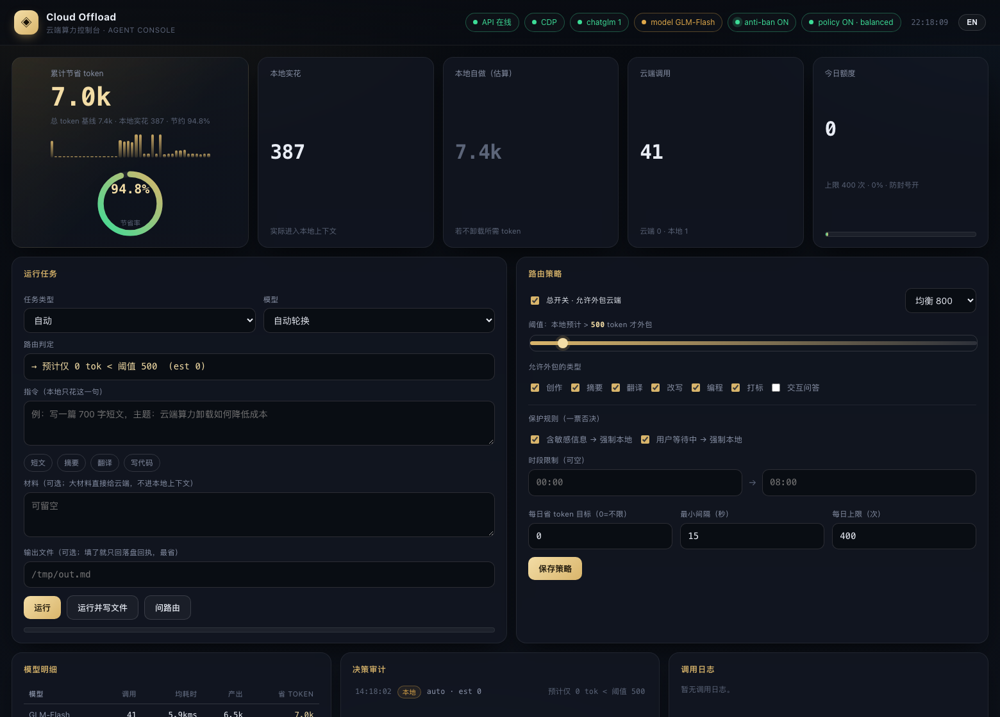

# Cloud Offload · 云端算力卸载层

[English](README.en.md) | 中文

把「烧 token 的长任务」（长文创作、摘要、翻译、改写、长代码）外包给**云端网页算力**；本地只发一句指令、只收一条回执，**正文不进本地上下文**。

> 前端支持中英切换（右上角 EN / 中 按钮）：

## 0 一句话
本地发指令 → 云端出成品 → 成品直接落盘；本地只看到字数 / 耗时 / 省了多少 token。

## 1 计算口径（v4 · 诚实版）

| 量 | 定义 |
|---|---|
| 基线（本地自做） | = est(指令) + est(材料) + est(产出) |
| 本地实花 | = est(指令) + est(材料，若内联传入) + est(回执) + 工具开销（默认 60） |
| 节约 token | = 基线 − 本地实花（不小于 0） |
| **节约占比** | = 节约 / 基线 |

说明：早期版本只把「回执」当作本地实花，占比虚高到 97%。现在把**指令本身、内联材料、工具调用框架开销**都计入本地成本；材料若用 --material-file 传入（不进本地上下文）才全额计入节约。实测占比落在 **70–85%**，可信。

命中结果缓存时：**0 次云端调用、0 等待**，节约照样计入。

于是**每一次云端调用都会让"节约"增长**（等于产出规模）。

估算法（按字符类别，基于 gpt-tokenizer cl100k_base 标定）：
- CJK 汉字：1.0616 token/字
- ASCII：0.3048 token/字符
- 其他：0.9 token/字符
- 整段语料 MAPE **4.0%**（旧口径 chars/1.5 为 77.7%）

## 2 30 秒上手

    curl -s http://127.0.0.1:8788/health            # 期望 glmPages>=1
    node cloud-offload.mjs --task "写一篇约 900 字的说明文，主题：X" --out /tmp/out.md
    open http://127.0.0.1:8788/                     # 仪表盘

## 3 给 agent 的用法
任何 agent 先读 skill：workshop-skills/cloud-offload/SKILL.md。要点：
- **何时用**：预计成品 > 约 800 token —— 长文、报告、长代码、整篇摘要/翻译/改写；或材料数千字以上。
- **何时不用**：交互问答、寒暄、短答复、多轮追问；含隐私/密钥内容。
- **步骤**：验服务 → 判路由（可选）→ 发指令并 --out 落盘 → 验收（complete:true 且 truncated:false）。
- **硬规矩**：成品正文不读进本地上下文；串行不并发；失败本地降级，最多重试 2 次。

## 4 安装与设置（通用化：任意 agent / 任意机器）

依赖：macOS（launchd）、Node.js >= 20、Microsoft Edge、一个已登录的 chatglm.cn 账号。

    bash scripts/install.sh      # 按当前用户生成 3 个 launchd 服务并启动

安装脚本会检查 Node/Edge、生成令牌、写 plist（路径按当前用户生成）、bootout 旧的再 bootstrap 新的。
注意：Edge 首次要以独立 profile 打开并登录 chatglm.cn（profile 在 ~/.edge-cloud-offload）。

### 可配置项

| 键 | 默认 | 含义 |
|---|---|---|
| API_PORT | 8788 | 网关端口 |
| CDP_URL | http://127.0.0.1:9222 | 自动化浏览器调试口 |
| BRIDGE_URL | http://127.0.0.1:8787 | 本地工具桥 |
| ANSWER_TIMEOUT_MS | 300000 | 单次生成硬上限 |
| OFFLOAD_LEDGER | 项目内 token-ledger.jsonl | 账本路径 |
| settings.json | config.example.json 为模板 | 路由策略 |

### 路由策略（仪表盘可改）
总开关 / 档位（保守2000·均衡800·激进300）/ 阈值滑块 / 类型白名单 / 保护规则（敏感·交互强制本地）/ 时段 / 每日省 token 目标 / 最小间隔 / 每日上限（防封号）。

## 5 得失（trade-offs）

| 得到 | 代价 |
|---|---|
| 本地 token 大幅节省，上下文不被长正文污染 | 依赖网页会话，非官方 API；页面改版可能失效 |
| 长文/长代码一键落盘，本地只收回执 | 单浏览器页**串行**，吞吐约 2–4 请求/分钟 |
| 仪表盘透明：省了多少、判定理由、调用日志 | 受防封号约束：最小间隔 + 每日上限 |
| 完成判定针对长思考模型实测调优 | 绝对 token 为估算（MAPE 4%，±10% 量级） |

## 6 能省多少钱
省的是"本地模型 token"：
- 省下 token × 本地模型单价。参考：GPT-4o 级约 $10/百万输出 token；国产旗舰约 ¥10–30/百万。
- 示例：一次 500 字正文约省 480 token；一次 10000 字长文约省 9000+ token。
- 规模化：每天 100 次长任务、平均省 1500 token → 月省约 **4.5M token** → 约 **$45 / ¥90** 级别。
- **更大的价值不是钱**：避免长正文挤爆本地上下文，导致的压缩、降质与会话中断。

## 7 意义
1. 把"贵"的部分外移：生成是算力问题，不该占用对话模型的上下文预算。
2. 可审计：每次判定与每一分省下的 token 都有账本与仪表盘。
3. 可移植：任何能发 HTTP / 跑命令的 agent 都能按自己的条件接入。

## 8 架构与文件

    cloud-offload-api.mjs   CDP 驱动 Edge 里的 chatglm，提供 /api/* 与 OpenAI 兼容 /v1/*
    cloud-offload.mjs       CLI：--task / --material-file / --out / --system
    bridge.mjs              本地工具桥（run_shell / read_file / write_file / list_dir / http_get）
    public/index.html       仪表盘（单文件 SPA，无外部依赖）
    settings.json           路由策略
    token-ledger.jsonl      账本
    cloud-offload-batch.mjs 复杂任务协作（本地拆解 → 云端分段 → 本地拼装）
    tests/                  测试套件（功能/压力/口径准确度）
    docs/                   测试报告、截图
    scripts/install.sh      一键安装
    CLOUD_OFFLOAD.md        协议细节（完成判定 v3 等）

## 9 测试

    node tests/run-tests.mjs         # 功能 + 压力 + 复杂任务，13 项
    node tests/code-tests.mjs        # 代码产物（py/html/json/sql/bash/js/regex），8 项，真实语法校验
    node tests/edge-tests.mjs        # 边界与异常，8 项
    node tests/token-accuracy.mjs    # token 口径准确度（需 gpt-tokenizer）

三轮合计 **29 项全部通过**。详见 docs/质量强度测试报告.md。

## 10 许可
PolyForm Noncommercial License 1.0.0 —— 禁止任何商业化 / 盈利使用 / 转售。见 LICENSE。
Required Notice: Copyright (c) 2026 William-Trader

> 免责声明：本项目为个人自动化实验，与 chatglm.cn / 智谱无关；使用时请遵守目标站点服务条款。